<p align="center">
  
</p>

<h1 align="center">Voxara</h1>

<p align="center">
  <b>A hearing-protection dosimeter for your wrist.</b><br>
  Wear OS app + Android phone companion, built with Kotlin and Jetpack Compose.
</p>

<p align="center">
  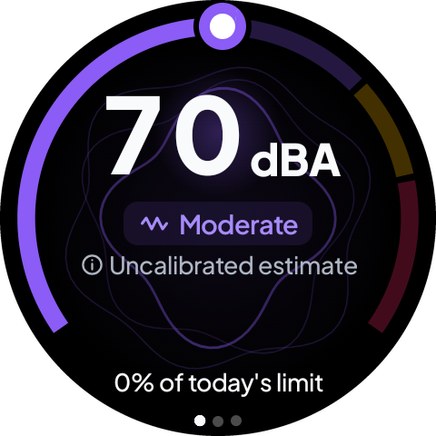
  &nbsp;
  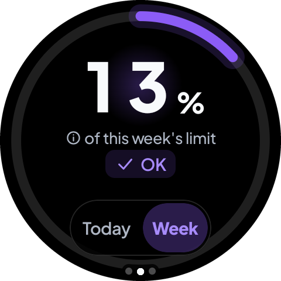
  &nbsp;
  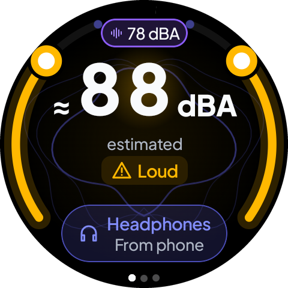
</p>

---

Voxara measures the sound level around you on the watch (in **dBA**), adds it up into a daily and a rolling-weekly **noise dose** based on NIOSH, estimates how loud your **headphones** are, and warns you *before* you reach the limit. One glance answers one question: *are my ears safe right now, and how much of today's allowance is left?*

A small AI coach, **Tono**, explains your status in plain language. Alerts and numbers never depend on the AI: they are computed on the watch, offline and deterministic. Tono only puts them into words.

> [!IMPORTANT]
> Voxara is **not a medical device**. Until you calibrate it against a reference meter, the microphone reading is an **uncalibrated estimate**. The app always says so on screen.

## Contents

- [Features](#features)
- [Screenshots](#screenshots)
- [How it works](#how-it-works)
- [Algorithms](#algorithms)
- [Project structure](#project-structure)
- [Tech stack](#tech-stack)
- [Getting started](#getting-started)
- [Running the apps](#running-the-apps)
- [Testing](#testing)
- [Design](#design)
- [Documentation](#documentation)
- [Privacy](#privacy)
- [License](#license)

## Features

### On the watch (Wear OS)

- **Live level**: the sound around you in dBA, on a 250° ring with four zones: OK (< 70), Moderate (70–84), Loud (85–94) and Dangerous (≥ 95). The zone is always shown as a word and an icon, never by colour alone.
- **Daily and weekly dose**: one progress ring for the share of today's limit (NIOSH: 85 dBA for 8 h, 3 dB exchange rate) or of the rolling last 7 days (WHO weekly sound allowance). Calm haptic alerts at 50 %, 80 % and 100 %.
- **Headphones mode**: switches on by itself when headphones are connected to the watch or the phone. It shows the estimated listening level, warns above a safe volume and offers **Lower volume**. It never lowers thresholds and never stops measuring the room.
- **Situation modes**: Auto, Quiet, Street, Transport, Work and Concert. Auto detects the scene with a small on-watch model (debug builds; see [the licence gate](#5-automatic-situation-detection-auto-mode)), and concerts with a deterministic rule.
- **Tono**: a short coaching line and a conversation screen (voice or text) that explains your numbers.
- **Guided calibration** against a sound level meter or a phone app, saved per microphone path and device model.
- **Always-on**: ambient mode, a foreground monitoring service, tiles and watch-face complications (dose and listening).
- **Accessible**: works on round screens from 192 to 240 dp, at font scale 1.3 and 2.0, with TalkBack labels and reduced motion.

### On the phone (Android)

- **Home**: today's ring, Tono's sentence, the last alert and quick tiles for the last 7 days and headphones.
- **Trends**: day, week and month charts, a heat calendar, the rolling weekly allowance and a hearing-care score.
- **Watch**: link status, a setup checklist, battery tips, calibration help and troubleshooting.
- **Headphones**: optional detection of the phone's own audio output, with your consent (off by default).
- **Settings** that sync with the watch, in light or dark theme with several accents, in English or Spanish.
- **CSV export**, delete-all-data and a home-screen **widget**.

## Screenshots

### Wear OS

Taken on the `Wear_OS_XL_Round` emulator (480 × 480 px, 240 dp). The level is the emulator's real microphone input.

| Now | Now (loud) | Dose: today | Dose: week | More |
|:---:|:---:|:---:|:---:|:---:|
|  | 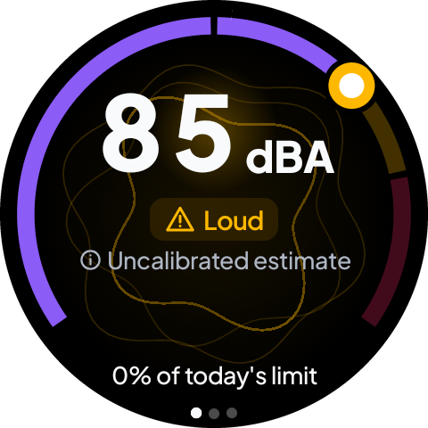 | 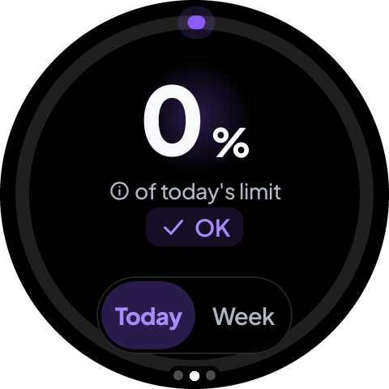 |  | 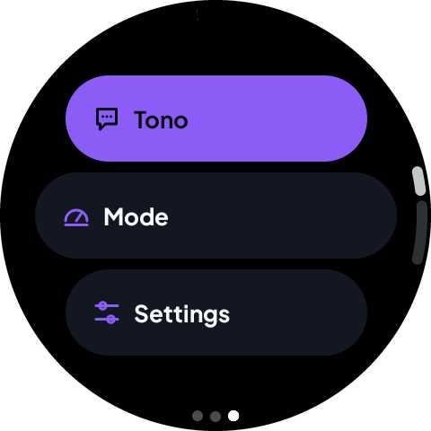 |

| Headphones mode | Volume alert | Tono | Mode | Settings |
|:---:|:---:|:---:|:---:|:---:|
|  | 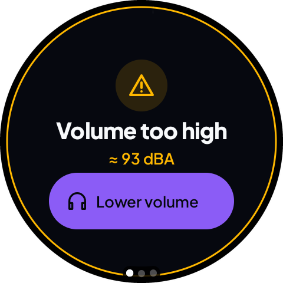 | 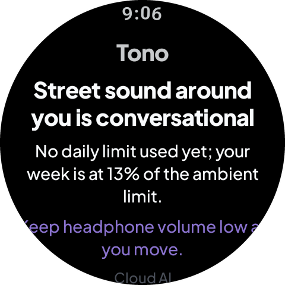 | 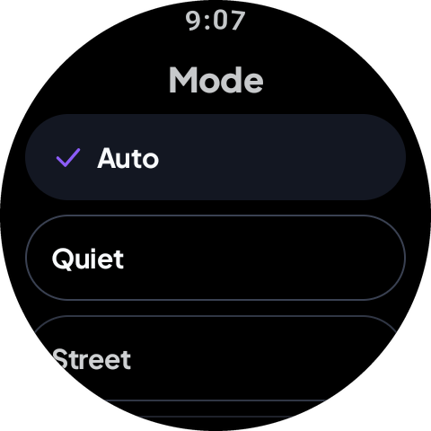 | 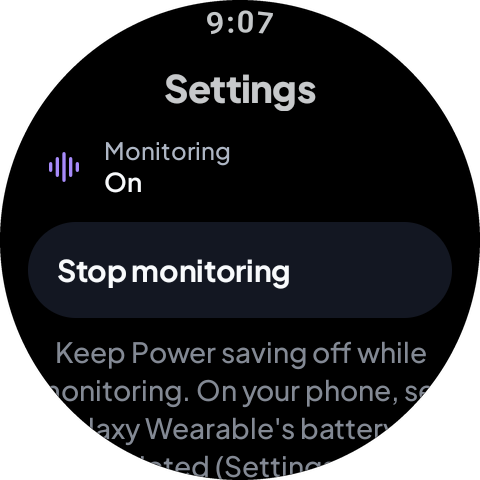 |

### Android phone

The phone's screens, rendered from the real Compose code with sample data by `PhoneRenderMatrixTest` (Roborazzi, phone size 360 × 800 dp):

| Home | Today | Trends | Tono |
|:---:|:---:|:---:|:---:|
| 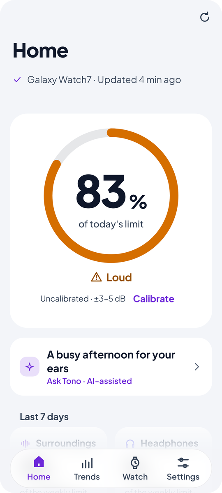 | 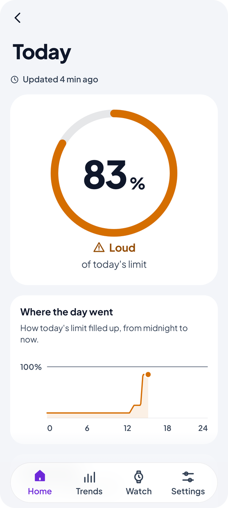 | 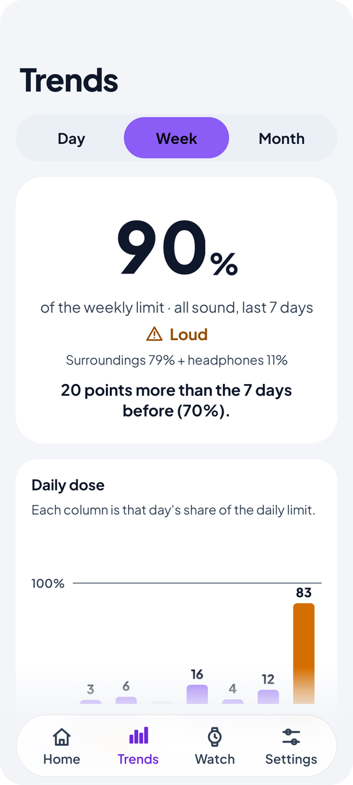 | 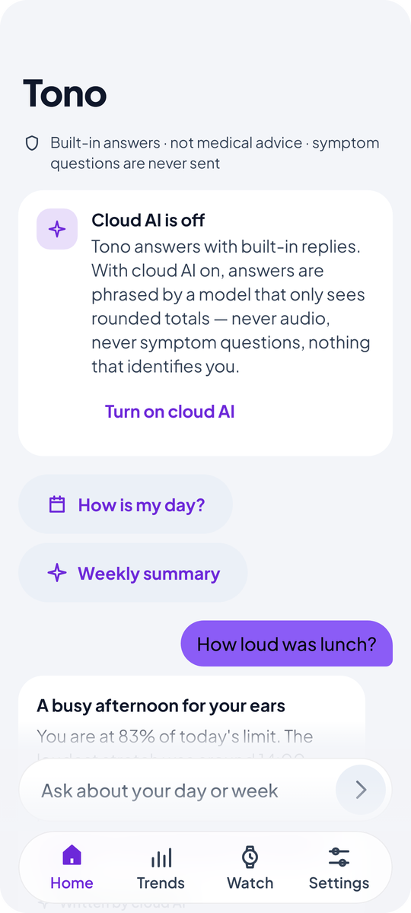 |

| Headphones | Watch | Home (dark) | Trends (dark) |
|:---:|:---:|:---:|:---:|
| 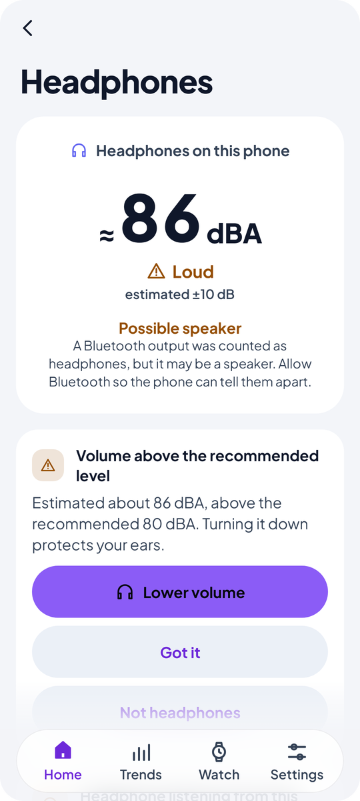 | 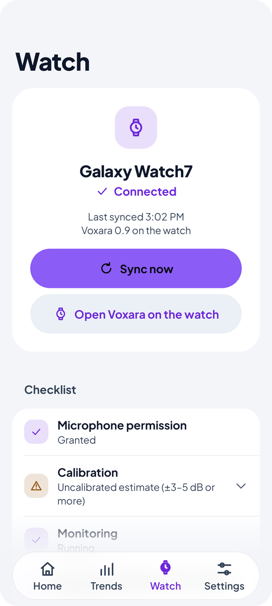 | 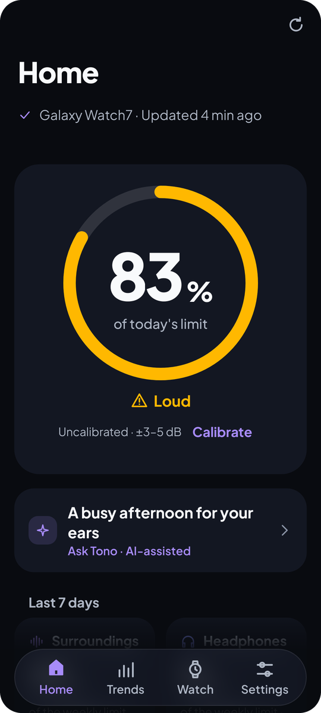 | 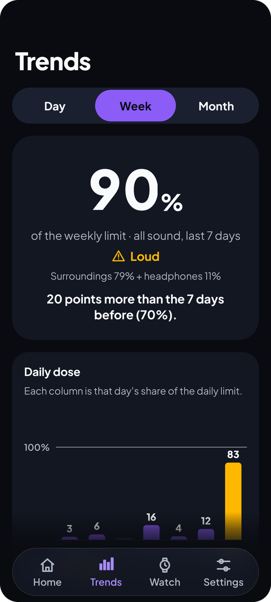 |

Taken on an Android 15 emulator (1080 × 2400 px): the first-run setup and Settings, and the Watch tab when no watch is linked (the emulator has no Wear OS connection).

| Welcome | Privacy | Tono and cloud AI | Settings | No watch linked |
|:---:|:---:|:---:|:---:|:---:|
| 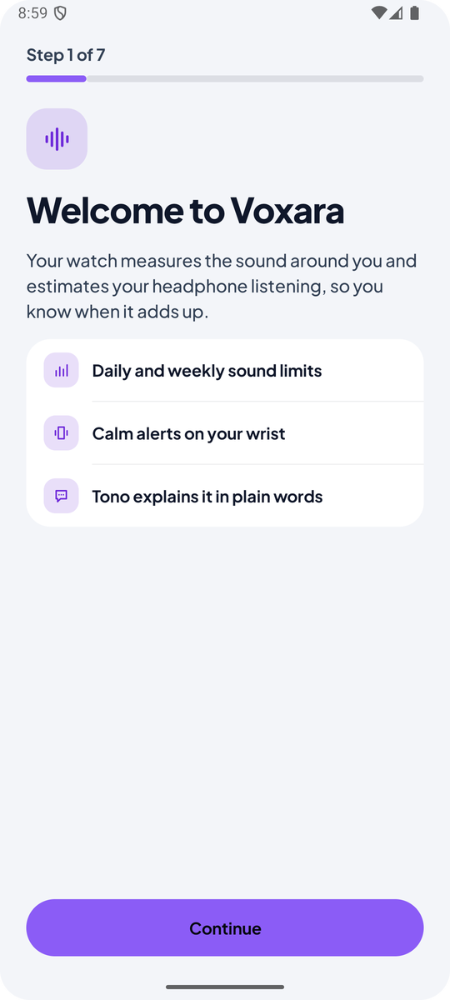 | 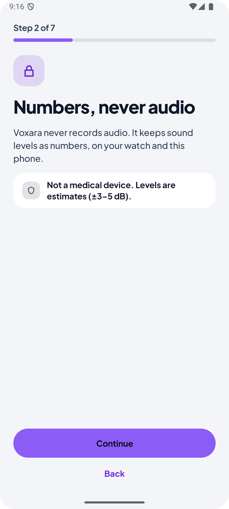 | 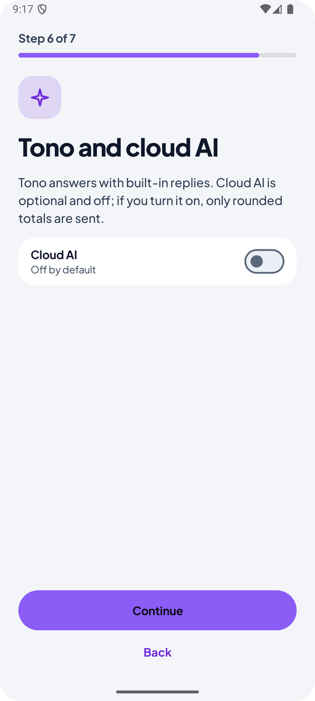 | 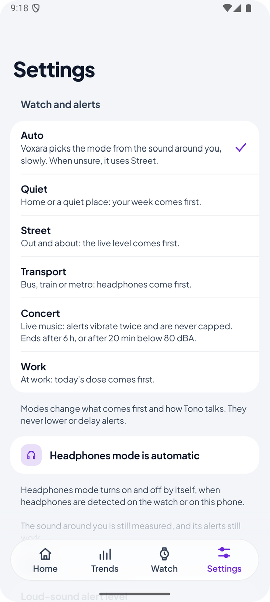 | 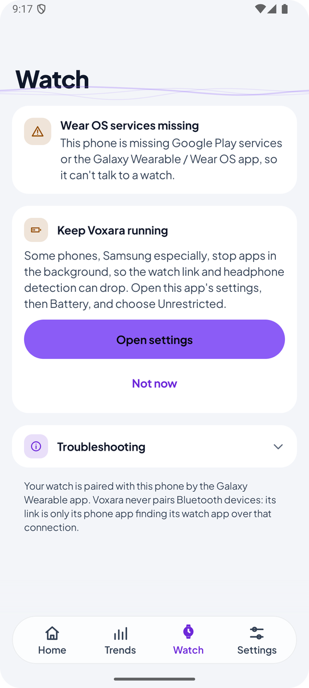 |

## How it works

```
 ┌─────────────────────────── Watch (:app) ───────────────────────────┐
 │ Microphone bursts ─► dBA level ─► NoiseDoseEngine ─► Ledger (35 d) │
 │                         │                │                         │
 │                    Situation /      AlertEngine ─► haptics,        │
 │                    scene model           │          notifications  │
 │                                     Tono (words only)              │
 └──────────────────────────────┬─────────────────────────────────────┘
                                │ Wearable Data Layer (status, ledger,
                                │ settings, headphone spans, commands)
 ┌──────────────────────────────▼─────────────────────────────────────┐
 │ Phone (:phone): history, trends, settings, headphone detection,    │
 │ Tono, widget, CSV export                                           │
 └────────────────────────────────────────────────────────────────────┘
```

- **Measurement**: `DosimeterService` (a foreground service of type microphone) samples short audio bursts, turns them into dBA with the calibrated offset of the active microphone path, and keeps going in ambient mode.
- **Dose**: `NoiseDoseEngine` (in `:shared`) gives the NIOSH permitted time at each level; minutes go into a ledger that feeds today's dose and the rolling 7-day dose.
- **Alerts**: `AlertEngine` decides deterministically and locally. Modes and headphones mode can never weaken an alert; tests such as `ModesNeverWeakenAlertsTest` and `AlertFloorsTest` guard this.
- **Headphones**: one `HeadphoneWatcher` reacts to audio-output events on both devices. The phone sends idempotent listening spans to the watch through a persisted outbox, so nothing is counted twice.
- **Tono**: an OpenAI-compatible chat client (DeepSeek by default) that receives a snapshot of the numbers and only writes the sentence. Cloud AI is enabled in **debug builds only**.

## Algorithms

Everything here is plain Kotlin in `:shared` (no Android imports where possible), deterministic, offline and unit-tested.

### 1. Sound level measurement

`AudioBurstSampler` (watch) reads short bursts of 48 kHz mono PCM from the microphone:

1. **A-weighting** with an IIR biquad cascade, frame by frame.
2. **RMS → dBFS → dBA**: `L = 20·log10(rms) + 94 + offset`, where `offset` is the calibration of the active microphone path (`UNPROCESSED` or `VOICE_RECOGNITION`).
3. **Leq** of the burst by energy-averaging the frame levels: `Leq = 10·log10(mean(10^(Lᵢ/10)))`.

**Calibration**: until you calibrate, the offset is a provisional value, and the UI says "uncalibrated estimate". Guided calibration does a 10 s steady capture against a reference meter. It requires a steady reading (standard deviation ≤ 2 dB), warns when the room is too quiet (< 50 dBA) or too loud (> 90 dBA), and stores `offset = reference − measured` per microphone path and device model.

**Adaptive cadence** (`SampleState`): the microphone opens only as often as the risk needs it.

| State | Level | Burst / period | Duty cycle |
|---|---|---|---|
| IDLE | < 65 dBA | 1 s every 60 s | 1.7 % |
| AMBIENT | 65–79 dBA | 1 s every 30 s | 3.3 % |
| ACCRUING | 80–94 dBA | 2 s every 10 s | 20 % |
| HAZARD | ≥ 95 dBA | continuous | 100 % |

Each burst stands in for the time until the next one, so the dose is duty-cycle corrected.

### 2. Noise dose (`NoiseDoseEngine`)

**Daily dose (NIOSH REL)**: 85 dBA for 8 hours, with a 3 dB exchange rate. Only levels ≥ 80 dBA count.

```
Permitted time   T(L) = 8 h / 2^((L − 85) / 3)
Daily dose       D    = 100 × Σ (Cᵢ / Tᵢ)            %    (Cᵢ = time spent at level Lᵢ)
8 h equivalent   TWA  = 10 × log10(D / 100) + 85     dBA
```

So 85 dBA gives 8 h, 88 dBA 4 h, 91 dBA 2 h, 94 dBA 1 h and 100 dBA 15 min. Headroom left at the current level is `T(L) × (1 − D/100)`.

**Weekly dose (WHO / ITU-T H.870)**: sound energy over the rolling last 7 days, `E = Σ p₀² · 10^(L/10) · t` in Pa²·h, compared with the weekly allowance of **1.6 Pa²·h** (0.51 Pa²·h for sensitive users). Ambient sound and headphone listening go into separate ledgers. A minute owned by the room is never counted again as headphones, and a minute reported by both the watch and the phone counts once (the louder one).

### 3. Risk zones and alerts (`RiskZone`, `AlertEngine`)

| Zone | Level |
|---|---|
| OK | < 70 dBA |
| Moderate | 70–84 dBA |
| Loud | 85–94 dBA |
| Dangerous | ≥ 95 dBA |

`AlertEngine` is a pure state machine that turns the numbers into alerts:

- **Daily dose**: 50 % (advisory), 80 % (warning), 100 % and every further 100 % (limit).
- **Weekly dose**: 80 % and 100 %, re-armed when it falls back below 70 %. Ambient and headphones are tracked separately.
- **Loud room**: sustained above the threshold (85 dBA by default, adjustable 80–95) for 3 minutes, re-armed 5 dB below it.
- **Headphone volume**: above 80 dBA for 8 s, in tiers (> 80, ≥ 90, ≥ 100 dBA); a higher tier always alerts.
- **Three tiers**: *advisory* (loud room, 50 %) counts against a daily cap of 4. *Warning* (80 %, loud headphones) can be snoozed for 1 h. Both have a 30 min cooldown and are held during quiet hours (they fire afterwards if the condition still holds). *Limit* (100 %) is never rate-limited: no cap, no snooze, no quiet hours, no cooldown.
- **Safety floor**: situation modes change how advice is worded and ordered, but they can never lower a threshold or delay an alert. `ModesNeverWeakenAlertsTest` and `AlertFloorsTest` guard this.

### 4. Headphone listening estimate

The microphone can't hear inside your ears, so headphone level is **estimated** from the output route and the volume setting (`estimateListening`). Full volume is taken as about **100 dBA** (the EN 50332 limit for portable players), minus the platform's own volume curve (`getStreamVolumeDb`), with a ±10 dB uncertainty. The UI always labels it as an estimate.

- **Route** (`chooseRoute`): wired/USB, then BLE headset, then A2DP. Speakers and car kits never count. Without Bluetooth permission, an A2DP output is flagged as a "possible speaker".
- **Detection** (`HeadphoneWatcher`): event-driven (device, playback and volume callbacks), plus a 2 s guard that runs only while something plays.
- **Spans** (`ListeningTracker`): a span is cut at every event (connect, play, pause, volume change), so seconds follow your ears, not a sampling period.
- **Two devices** (`effectiveListening`): when both the watch and the phone play, the louder estimate is the one that counts.
- **Lower volume**: "Lower to safe volume" picks the highest volume step whose estimate is ≤ 80 dBA (`safeVolumeIndex`). It never raises the volume, and it reads the volume back to confirm.

### 5. Automatic situation detection (Auto mode)

Auto picks **Quiet, Street, Transport or Work** with a small neural network that runs on the watch, and **Concert** with a deterministic rule. It reuses the bursts the dosimeter already captures, so it adds no microphone time. Audio and features are never stored: each feature vector is dropped right after its vote.

**Features** (`SceneFeatures`, 54 numbers per 0.98 s of unweighted audio): 1024-point Hann FFT frames, then 24 mel bands (50 Hz–12 kHz). From these: spectral shape (independent of gain), per-band temporal variation, centroid, flatness, frame-level variation, positive spectral flux and local tonality. There is no absolute level in the vector; the level comes from the calibrated dBA chain. The Kotlin extractor matches the Python training extractor to ≤ 1e-7 (`SceneFeaturesParityTest`).

**Model** (`SceneModel`): an MLP **54 → 32 → 15** (ReLU, softmax). That is 2,363 parameters and about 2,200 multiply-adds per vote, as plain Kotlin constants with no TFLite. It was trained on **TUT Acoustic Scenes 2017** (15 scenes), with augmentation that imitates a wrist MEMS microphone. The 15 scene probabilities are summed into the 4 modes:

| Mode | Scenes |
|---|---|
| Quiet | home, library, forest path, park, lakeside beach |
| Street | city centre, residential area, café/restaurant, grocery store |
| Transport | bus, tram, train, car, metro station |
| Work | office |

On the official evaluation split (109 locations never seen in training), it gets about **72 % mode accuracy per 10 s** (67 % balanced). Transport is the most reliable (85 % recall). Quiet is often taken for Street, and Work is the weakest class.

**Detector** (`AutoModeDetector`): turns noisy votes into a calm decision.

1. **Level vetoes**: below 38 dBA it's Quiet. Quiet is impossible above 70 dBA, Work above 80 dBA, and Transport below 50 dBA.
2. **Priors**: headphones playing boost Transport (×1.3), and night (22:00–06:00) halves Work.
3. **Voting**: a 5-minute window weighted by recency (half-life 60 s), at least 2 votes, at most one every 5 s. Mean confidence and agreement must both be ≥ 0.5.
4. **Hysteresis**: a new mode must win 2 evaluations in a row, then stay at least 90 s. While unsure, extra "fast votes" (every 15 s, from a small budget) speed things up.
5. **Doubt**: the current mode is kept while unsure. After 10 min without support, or 15 min without votes, Auto falls back to **Street**.

**Concert rule** (no training data has concerts): it enters Concert when, over the last 3 minutes, the median level is ≥ 90 dBA, ≥ 35 % of the votes are music-like (local tonality ≤ −3.12 dB) and no headphones are playing, and all of this holds for 2 minutes. It leaves after 20 minutes below 80 dBA. The tonality threshold was derived **only from freely licensed live music**. On 142 loud transport recordings (metro, train, tram, bus, car, city centre) it triggered no false Concert.

> [!NOTE]
> **Licence gate**: the TUT dataset is licensed for non-commercial use only. So the model's weights live only in `shared/src/debug`. **Release builds contain no weights**: there, Auto runs the Concert rule only and otherwise means Street. A Gradle check (`verifyReleaseHasNoSceneWeights`) and `SceneWeightsLayoutTest` enforce this. Shipping the model needs commercially licensed training data; the pipeline stays the same.

## Project structure

| Module | What it is |
|---|---|
| [`app/`](app) | The **Wear OS** app: dosimeter service, glance pages (Now, Dose, More), tiles, complications, Tono, calibration. `minSdk 30`. |
| [`phone/`](phone) | The **phone companion**: Home, Trends, Watch, Settings, headphones, widget, export. Same `applicationId` and signing key as the watch app. `minSdk 28`. |
| [`shared/`](shared) | Pure Kotlin logic used by both apps: dose, ledger, alerts, risk, calibration, situation detection, headphones, settings sync, link protocol. |
| [`shared-ui/`](shared-ui) | Design pieces both apps share: fonts, level colours, wave visuals, rolling digits. |
| [`baselineprofile/`](baselineprofile) | Baseline Profile generator and macrobenchmarks for the phone. |
| [`docs/`](docs) | Design system, redesign records, reliability audit and test plan, screenshots. |

## Tech stack

- **Kotlin** 2.2, **Android Gradle Plugin** 9.3, compile/target SDK 37
- **Jetpack Compose**: Wear Compose Material 3 on the watch, Compose Material 3 on the phone
- **Wear OS**: Tiles and ProtoLayout, watch-face complications, Ongoing Activity
- **Play Services Wearable** (Data Layer) for watch ↔ phone sync
- **DataStore**, **WorkManager**, **Kotlin Coroutines**, **Navigation Compose**, **Glance** (widget)
- **Haze** for the phone's translucent bars
- **Testing**: JUnit 4, Robolectric, **Roborazzi** screenshot tests, Baseline Profiles and Macrobenchmark

## Getting started

### Requirements

- **Android Studio** (a recent version that supports AGP 9.3)
- Android SDK 37
- A Wear OS device or emulator (round), and optionally an Android phone or emulator

### Clone and build

```bash
git clone <repository-url>
cd Voxara
./gradlew :app:assembleDebug :phone:assembleDebug
```

> [!TIP]
> If Gradle fails at `JdkImageTransform` / `jlink`, your default JDK has no `jlink`. Point `JAVA_HOME` to the JDK that ships with Android Studio:
>
> ```bash
> export JAVA_HOME="/c/Program Files/Android/Android Studio/jbr"   # Git Bash on Windows
> ./gradlew --stop
> ```

### Optional: Tono (AI coach)

Tono is optional. Without a key (or with cloud AI turned off) the apps work fully, and Tono uses built-in answers offline. To enable the cloud AI in **debug** builds, add these to `local.properties` (never commit this file):

```properties
AI_API_KEY=your-key-here
# Optional, these are the defaults:
AI_BASE_URL=https://api.deepseek.com
AI_MODEL=deepseek-flash
```

Release builds never contain the key.

## Running the apps

```bash
# Watch
./gradlew :app:installDebug
# Phone
./gradlew :phone:installDebug
```

With both a watch and a phone connected, pick the device with `adb -s <serial>`, or run each configuration from Android Studio.

To use a real watch over Wi-Fi, turn on **Wireless debugging** on the watch, then:

```bash
adb mdns services          # find the watch's ip:port
adb connect <ip>:<port>
```

On first launch the watch asks for the microphone and notification permissions, and the phone runs a short setup.

## Testing

```bash
./gradlew :shared:testDebugUnitTest      # dose, alerts, ledger, sync, situation detection
./gradlew :app:testDebugUnitTest         # watch UI, layout and screenshot tests
./gradlew :phone:testDebugUnitTest       # phone UI, figures, charts and font-scale tests
./gradlew :app:lintDebug
```

Screenshot tests use **Roborazzi** on Robolectric. The watch renders go to `app/build/screenshots/` (every screen at 192, 203, 216, 227 and 240 dp, and font scale 1.0, 1.3 and 2.0). The phone render matrix is opt-in because it is slow:

```bash
VOXARA_SHOTS_DIR=/abs/path/to/out ./gradlew :phone:testDebugUnitTest --tests '*PhoneRenderMatrixTest*'
```

Tests check, among other things:

- no text is cut or broken mid-word on any screen size or font scale;
- WCAG AA contrast for every accent, in light and dark;
- alert floors that no mode can lower;
- Home, Today and Trends all show the same figures.

### Debug-only controls

Debug builds of the watch app accept display-only commands over adb. This lets you see states the emulator cannot produce. They write no dose, no ledger and no alerts:

```bash
adb shell am broadcast -a com.example.voxara.DEBUG --ei listen 85          # headphones playing at ~85 dBA (-1 = off)
adb shell am broadcast -a com.example.voxara.DEBUG --ez phone true         # the phone reported headphones
adb shell am broadcast -a com.example.voxara.DEBUG --es hpalert 2:93.0     # show the headphone-volume alert
adb shell am broadcast -a com.example.voxara.DEBUG --ef crown 3            # a real rotary (crown) event
adb shell am broadcast -a com.example.voxara.DEBUG --ed dba 72.0           # room level (used when the mic is denied)
```

None of this code ships: release builds get a no-op.

## Design

Both apps share one visual language, **"Orbit"**: a pure black AMOLED background on the watch, a violet accent, amber and crimson for the loud and dangerous tiers, and the fonts *Plus Jakarta Sans* and *JetBrains Mono*. The watch is a pager of three round "heroes" (Now, Dose, More). The phone is built to feel like the watch's other half.

Design rules the code follows:

1. One glance, one answer: level, zone and dose before anything else.
2. Safety statements are never hidden or softened by styling.
3. Colour never carries a zone alone: a word and an icon always go with it.
4. Calm by default: motion and haptics only mark state changes. No animation in ambient mode, and reduced motion is respected.
5. Estimates are labelled as estimates.

All strings are resources in **English** and **Spanish**.

## Documentation

| Document | Content |
|---|---|
| [`PRODUCT.md`](PRODUCT.md) | Users, purpose, constraints and principles |
| [`DESIGN.md`](DESIGN.md) | Design tokens and components of the watch and the phone |
| [`docs/design/STYLE.md`](docs/design/STYLE.md) | Colours, type, shapes and where each value lives in code |
| [`docs/design/watch-redesign/`](docs/design/watch-redesign) | The watch "Orbit" redesign, pass by pass |
| [`docs/design/phone-redesign/`](docs/design/phone-redesign) | The phone redesign and where every piece of information went |
| [`docs/reliability/`](docs/reliability) | Reliability audit, feature map and test plan |
| [`PROGRESS.md`](PROGRESS.md) | Detailed development log, phase by phase |

## Privacy

- Sound is turned into levels on the watch. **No audio is recorded or stored.**
- Levels per minute (35 days), settings and calibration stay on your devices and sync only between your watch and your phone.
- Tono's cloud AI asks for your consent first, and then sends only numbers (dose percentages, rounded dBA, minutes, rough time of day). It never sends audio, song or app names, or location. With it off, Tono uses built-in answers and works offline.
- The phone's headphone detection is opt-in and off by default.

## License

Copyright 2026 jefer02.

Voxara is licensed under the [Apache License 2.0](LICENSE). Third-party fonts, libraries and data keep their own licences; see [`THIRD_PARTY_NOTICES.md`](THIRD_PARTY_NOTICES.md). The scene model weights in debug builds come from non-commercial training data and are **not** covered by the Apache licence.
